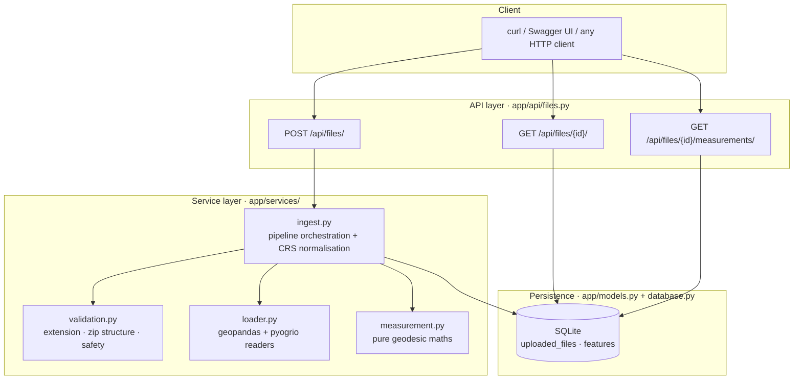
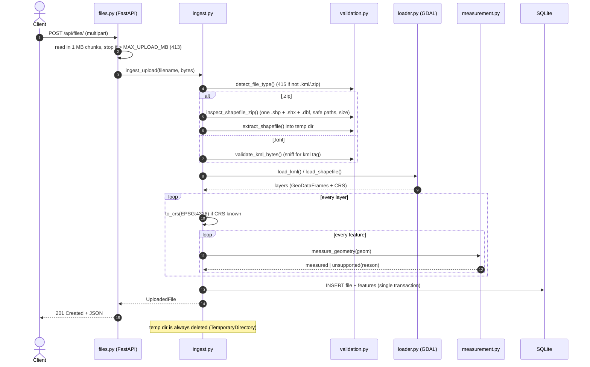
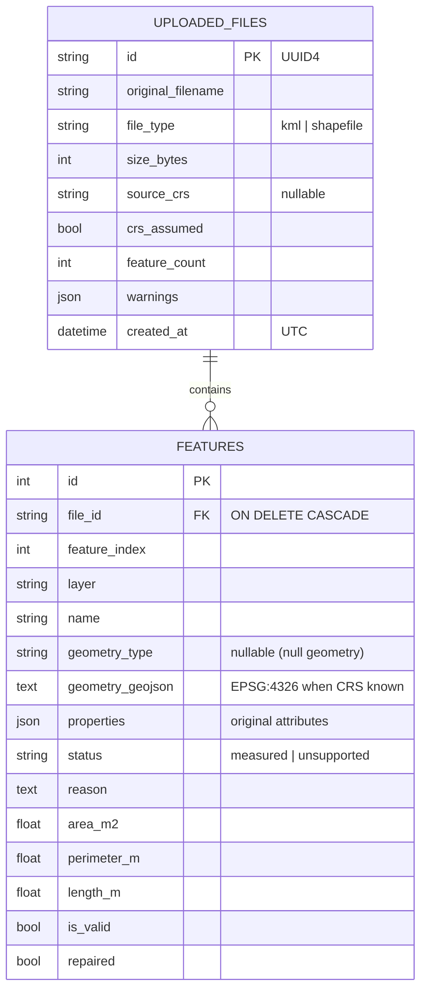
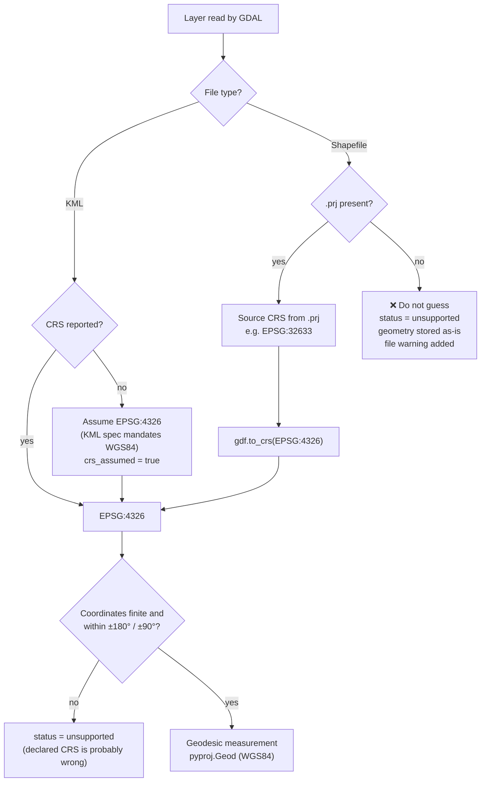

<div align="center">

# 🌍 Geospatial File Measurement API

**Upload a KML or a zipped shapefile, get accurate real-world area, perimeter and length for every feature.**


[](https://github.com/yadavchandan84/geospatial-measurement-api/actions/workflows/tests.yml)

</div>

---

## 📌 Overview

This service takes in geospatial vector files, stores every feature in a database, and measures each one **geodesically on the WGS84 ellipsoid**. The results are in metres and square metres and are correct anywhere on Earth, whatever projection the source file used.

It is built to **never crash on bad geodata**. Multi-part geometries, holes, points, null or empty geometries, self-intersecting polygons and files with no CRS all produce a clear, structured answer instead of a stack trace.

```text
 .kml / .zip(shp)  ──►  validate  ──►  read (GDAL)  ──►  reproject → EPSG:4326  ──►  geodesic measure  ──►  SQLite
                                                                                                         │
                         GET /api/files/{id}/   ◄──────────  GET /api/files/{id}/measurements/  ◄────────┘
```

### Highlights

| | |
|---|---|
| 📂 **Formats** | `.kml` (all folders/layers) and `.zip` containing one ESRI shapefile |
| 📐 **Measurements** | Area (m², km²), perimeter (m) and length (m), per feature and as file totals |
| 🌐 **Accuracy** | Geodesic on the WGS84 ellipsoid via `pyproj.Geod` (GeographicLib), not planar maths in degrees |
| 🧭 **CRS aware** | Any input CRS from `.prj` is reprojected to EPSG:4326. A missing CRS is reported, never guessed |
| 🛡️ **Robust** | Multi\*, holes, Z values, null/empty, points and invalid polygons all handled gracefully |
| 🔒 **Safe uploads** | Size limits, zip-bomb and zip-slip guards, server-controlled extraction paths |
| 🧪 **Tested** | 40 pytest tests: unit, end-to-end and validation, with a known 1 km² reference square |

---

## 📚 Table of contents

1. [Quick start](#-quick-start)
2. [API reference](#-api-reference)
3. [Architecture](#-architecture)
4. [CRS flow](#-crs-flow)
5. [How measurement works](#-how-measurement-works)
6. [Edge-case handling](#-edge-case-handling)
7. [Design decisions](#-design-decisions)
8. [Testing](#-testing)
9. [Project structure](#-project-structure)
10. [Configuration](#%EF%B8%8F-configuration)
11. [Limitations](#-limitations)
12. [Learning and future scope](#-learning-and-future-scope)

---

## 🚀 Quick start

**Prerequisites:** Python 3.11 or newer. GDAL ships inside the `pyogrio` wheel, so you don't need to install it on your system.

```bash
# 1. Clone
git clone https://github.com/yadavchandan84/geospatial-measurement-api.git
cd geospatial-measurement-api

# 2. Create and activate a virtual environment
python -m venv .venv
.venv\Scripts\activate            # Windows (PowerShell)
# source .venv/bin/activate       # macOS / Linux

# 3. Install dependencies (runtime + test)
pip install -r requirements-dev.txt

# 4. Run the API
uvicorn app.main:app --reload
```

| URL | What |
|---|---|
| http://127.0.0.1:8000/docs | Swagger UI (try every endpoint from the browser) |
| http://127.0.0.1:8000/redoc | ReDoc API documentation |
| http://127.0.0.1:8000/health | Health check, returns `{"status": "ok"}` |

The SQLite database is created automatically at `data/geospatial.db` on first start.

### Try it in 30 seconds

Sample files are included in [`samples/`](samples/):

| File | Contents | Expected result |
|---|---|---|
| `square_1km.kml` | One 1 km × 1 km polygon | ≈ 1,000,800 m² |
| `mixed_geometries.kml` | MultiGeometry, polygon with hole, line, point, Placemark without geometry | 3 measured, 2 unsupported |
| `parcels_utm33n.zip` | Polygon + MultiPolygon in UTM 33N (EPSG:32633) | ≈ 3,002,400 m² total |
| `boundary_line_utm33n.zip` | 1 km line in UTM 33N | ≈ 1,000.4 m |
| `square_missing_crs.zip` | Shapefile **without** a `.prj` | Upload succeeds, feature marked unsupported |

```bash
curl -F "file=@samples/parcels_utm33n.zip" http://127.0.0.1:8000/api/files/
```

Regenerate the zipped samples at any time with `python scripts/generate_samples.py`.

---

## 📖 API reference

| Method | Endpoint | Purpose | Success |
|---|---|---|---|
| `POST` | `/api/files/` | Upload a `.kml` or a `.zip` with a shapefile | `201 Created` |
| `GET` | `/api/files/{id}/` | File metadata + features (GeoJSON geometry) | `200 OK` |
| `GET` | `/api/files/{id}/measurements/` | Area / perimeter / length per feature + totals | `200 OK` |

### 1️⃣ `POST /api/files/`: upload a file

Send it as `multipart/form-data` with one field named **`file`**.

**Accepted inputs**

| Extension | Requirements |
|---|---|
| `.kml` | A KML document. Every `<Folder>` becomes a layer and all of them are read. |
| `.zip` | Exactly **one** shapefile with **`.shp` + `.shx` + `.dbf`** (required). `.prj` is recommended and `.cpg` is used if present. Files may be inside sub-folders. |

Extensions are matched case-insensitively, so `PARCELS.ZIP` works.

<details open>
<summary><b>Example request</b></summary>

```bash
# curl (macOS / Linux / Windows)
curl -F "file=@samples/parcels_utm33n.zip" http://127.0.0.1:8000/api/files/
```

```powershell
# PowerShell 7+
Invoke-RestMethod -Method Post -Uri http://127.0.0.1:8000/api/files/ -Form @{ file = Get-Item samples/parcels_utm33n.zip }
```

```python
# Python (httpx)
import httpx

with open("samples/parcels_utm33n.zip", "rb") as f:
    r = httpx.post("http://127.0.0.1:8000/api/files/", files={"file": ("parcels_utm33n.zip", f)})
file_id = r.json()["id"]
```
</details>

<details open>
<summary><b>Example response</b>: <code>201 Created</code></summary>

```json
{
  "id": "255bfec6-579a-4480-9542-b29164119f48",
  "original_filename": "parcels_utm33n.zip",
  "file_type": "shapefile",
  "size_bytes": 989,
  "source_crs": "EPSG:32633",
  "crs_assumed": false,
  "feature_count": 2,
  "warnings": [],
  "created_at": "2026-10-07T16:52:40.441702Z",
  "summary": { "measured_features": 2, "unsupported_features": 0 },
  "features": [
    {
      "id": 1,
      "feature_index": 0,
      "layer": "parcels",
      "name": "square_1km",
      "geometry_type": "Polygon",
      "status": "measured",
      "reason": null,
      "properties": { "name": "square_1km" },
      "geometry": {
        "type": "Polygon",
        "coordinates": [[[15.012682, 44.973440], [15.0, 44.973441], "…"]]
      }
    }
  ]
}
```
</details>

**File fields**

| Field | Type | Description |
|---|---|---|
| `id` | UUID string | Identifier used by the GET endpoints |
| `file_type` | `"kml"` \| `"shapefile"` | Detected from the extension |
| `source_crs` | string \| `null` | CRS declared by the file, e.g. `EPSG:32633`. `null` when missing |
| `crs_assumed` | bool | `true` if the CRS wasn't in the file but is implied by the format (KML ⇒ WGS84) |
| `warnings` | string[] | File-level notes, e.g. *"Layer 'x' has no CRS; measurements were skipped."* |
| `summary` | object | Counts of `measured` vs `unsupported` features |
| `features[].geometry` | GeoJSON \| `null` | **EPSG:4326** when the CRS is known, otherwise the original coordinates |

### 2️⃣ `GET /api/files/{id}/`: file details

Returns the same body as the upload response. Use `?include_geometry=false` to drop the GeoJSON when you only need metadata.

```bash
curl "http://127.0.0.1:8000/api/files/255bfec6-579a-4480-9542-b29164119f48/?include_geometry=false"
```

### 3️⃣ `GET /api/files/{id}/measurements/`: measurements

```bash
curl http://127.0.0.1:8000/api/files/255bfec6-579a-4480-9542-b29164119f48/measurements/
```

<details open>
<summary><b>Example response</b>: <code>200 OK</code></summary>

```json
{
  "file_id": "255bfec6-579a-4480-9542-b29164119f48",
  "source_crs": "EPSG:32633",
  "measurement_crs": "EPSG:4326",
  "method": "geodesic on the WGS84 ellipsoid (pyproj.Geod)",
  "units": { "area": "m^2", "length": "m", "perimeter": "m" },
  "totals": {
    "area_m2": 3002400.78,
    "area_km2": 3.0024,
    "perimeter_m": 12004.80,
    "length_m": 0.0,
    "measured_features": 2,
    "unsupported_features": 0
  },
  "features": [
    {
      "feature_id": 1, "feature_index": 0, "layer": "parcels", "name": "square_1km",
      "geometry_type": "Polygon", "status": "measured", "reason": null,
      "area_m2": 1000800.47, "area_km2": 1.0008, "perimeter_m": 4001.60,
      "length_m": null, "is_valid": true, "repaired": false
    },
    {
      "feature_id": 2, "feature_index": 1, "layer": "parcels", "name": "two_squares",
      "geometry_type": "MultiPolygon", "status": "measured", "reason": null,
      "area_m2": 2001600.31, "area_km2": 2.0016, "perimeter_m": 8003.20,
      "length_m": null, "is_valid": true, "repaired": false
    }
  ]
}
```
</details>

**Measurement fields**

| Field | Meaning |
|---|---|
| `status` | `"measured"`, or `"unsupported"` when the feature can't be measured (see `reason`) |
| `area_m2` / `area_km2` / `perimeter_m` | Set for polygonal geometries, `null` otherwise |
| `length_m` | Set for linear geometries, `null` otherwise |
| `is_valid` | Whether the source geometry was topologically valid |
| `repaired` | `true` if an invalid geometry was fixed with `make_valid` before measuring |
| `totals` | Sums over **measured** features only |

<details>
<summary><b>What an unsupported feature looks like</b> (shapefile without <code>.prj</code>)</summary>

```json
{
  "feature_id": 3,
  "name": "square_no_crs",
  "geometry_type": "Polygon",
  "status": "unsupported",
  "reason": "Source CRS is missing (no .prj file); coordinates cannot be converted to real-world units, so measurement was skipped.",
  "area_m2": null,
  "perimeter_m": null,
  "length_m": null
}
```
</details>

### ❗ Errors

Feature-level problems never fail a request. HTTP errors are reserved for problems with **the file as a whole**. Every error has the same shape:

```json
{ "detail": "Shapefile is incomplete; missing required component(s): .shx." }
```

| Status | When it happens |
|---|---|
| `400 Bad Request` | Empty file · not a real zip · no `.shp` · missing `.shx`/`.dbf` · more than one shapefile · unsafe paths (`../`) |
| `404 Not Found` | Unknown file `id` |
| `413 Payload Too Large` | Upload over `MAX_UPLOAD_MB`, or zip contents over `MAX_UNCOMPRESSED_MB` |
| `415 Unsupported Media Type` | Extension isn't `.kml` or `.zip` |
| `422 Unprocessable Entity` | File passed the checks but can't be parsed (corrupt shapefile, not actually KML) |

---

## 🏗 Architecture

The app follows a **layered design**. HTTP concerns, the processing pipeline, the geospatial logic and persistence each live in their own module, so every layer can be understood and tested on its own.



### Layer responsibilities

| Layer | Module | Responsibility | Knows about HTTP? |
|---|---|---|---|
| **API** | `app/api/files.py` | Routing, size-limited reads, mapping `UploadError` → HTTP status, building response models | ✅ |
| **Pipeline** | `app/services/ingest.py` | Orchestrates validate → read → reproject → measure → persist. Converts properties to JSON-safe values | ❌ |
| **Validation** | `app/services/validation.py` | Extension whitelist, KML sniffing, zip inspection, zip-slip/zip-bomb guards, safe extraction | ❌ |
| **Readers** | `app/services/loader.py` | Reads KML (multi-layer) and shapefiles with GDAL. Recovers Placemarks GDAL drops | ❌ |
| **Measurement** | `app/services/measurement.py` | Pure function: shapely geometry (EPSG:4326) → area/perimeter/length or an "unsupported" result | ❌ |
| **Persistence** | `app/models.py`, `app/database.py` | SQLAlchemy 2 ORM models, engine/session, SQLite foreign keys | ❌ |
| **Contracts** | `app/schemas.py` | Pydantic response models, which also drive the OpenAPI docs | ❌ |
| **Config** | `app/config.py` | `pydantic-settings`: DB URL and limits from env / `.env` | ❌ |

### Upload request lifecycle



### Data model



Measurements are computed **once at upload** and stored next to the geometry, so both GET endpoints are simple reads.

---

## 🧭 CRS flow

Getting the coordinate reference system right is what makes the numbers trustworthy. Every feature takes exactly one path through this decision tree:



| Step | What happens | Why |
|---|---|---|
| **1. Detect** | KML → WGS84 by spec. Shapefile → CRS from `.prj` | Use only what the file actually declares |
| **2. Normalise** | Reproject every layer to **EPSG:4326** | One canonical CRS for storage, GeoJSON (RFC 7946) and measurement |
| **3. Sanity-check** | Reject non-finite or out-of-range lon/lat after reprojection | Catches metre coordinates mislabelled as degrees before they become nonsense areas |
| **4. Measure** | Geodesic maths on the WGS84 ellipsoid | Accurate everywhere, no per-feature projection choice |
| **5. Missing CRS** | Feature marked `unsupported`, upload still `201` | A wrong-but-plausible area is worse than an honest "can't measure" |

---

## 📐 How measurement works

Measurement lives in [`app/services/measurement.py`](app/services/measurement.py). It is a **pure function** with no I/O and no database, so it is easy to unit-test.

```text
measure_geometry(geom in EPSG:4326)
 ├─ None              → unsupported "Feature has no geometry (null)."
 ├─ empty             → unsupported "Geometry is empty."
 ├─ force_2d          (drop KML altitude / Z values)
 ├─ invalid?          → shapely.make_valid → is_valid=false, repaired=true
 └─ walk parts recursively
      Polygon         area = |exterior| − Σ|holes|, perimeter = exterior + holes
      LineString/Ring length
      Multi*/Collection → sum of parts
      Point/MultiPoint  no metric → unsupported if nothing else is measurable
```

- **Geodesic, not planar.** `pyproj.Geod(ellps="WGS84")` wraps [GeographicLib](https://geographiclib.sourceforge.io/), which solves the ellipsoidal problem directly. There's no "which UTM zone?" question, and large or zone-crossing features stay accurate.
- **Orientation-independent.** Ring areas are taken as absolute values, so clockwise and counter-clockwise rings give the same result.
- **Holes are handled explicitly.** Each interior ring's area is subtracted and its length is added to the perimeter.

### Sanity check: why is a 1 km × 1 km square 1,000,800 m²?

The reference square is drawn as exactly **1000 m × 1000 m in UTM zone 33N** and then converted to lon/lat. UTM deliberately shrinks distances on its central meridian by a **scale factor of 0.9996**, so 1000 "map metres" are about 1000.4 real metres:

```text
true area = 1000² / 0.9996² ≈ 1,000,800 m²   (+0.08%)
```

The geodesic result exposes the projection's distortion, which is exactly why this API measures on the ellipsoid. The tests compare against **1,000,000 m² with a 0.5% tolerance**.

---

## 🛡 Edge-case handling

| Case | Behaviour | `status` |
|---|---|---|
| `MultiPolygon` / `MultiLineString` | Parts measured and summed | measured |
| `GeometryCollection` | Polygon parts → area, line parts → length | measured |
| Polygon with holes | Hole area subtracted, hole edges added to perimeter | measured |
| Clockwise / counter-clockwise rings | Absolute area, same result either way | measured |
| 3D coordinates (KML altitude) | Z dropped before measuring | measured |
| Self-intersecting ("bow-tie") polygon | Repaired with `make_valid`, flagged `is_valid=false, repaired=true` | measured |
| `Point` / `MultiPoint` | No area or length | unsupported |
| Null geometry | "Feature has no geometry (null)." | unsupported |
| Empty geometry | "Geometry is empty." | unsupported |
| KML Placemark **without** geometry | GDAL drops it silently. Recovered from the XML into layer `placemarks_without_geometry` | unsupported |
| Shapefile without `.prj` | Not guessed. Feature stored in source coordinates, file warning added | unsupported |
| CRS doesn't match coordinates | "Coordinates fall outside the valid longitude/latitude range…" | unsupported |
| Corrupt / unparsable file | `422` with the reader's message, never a `500` | n/a |

### Upload safety

| Threat | Mitigation |
|---|---|
| Huge uploads | Read in 1 MB chunks and stop as soon as `MAX_UPLOAD_MB` is exceeded → `413` |
| Zip bombs | Total uncompressed size (`MAX_UNCOMPRESSED_MB`) and entry count (`max_zip_entries`) checked **before** extraction |
| Zip slip (`../../etc/passwd`) | Absolute, drive-letter and `..` paths rejected. Files are written to server-chosen names (`layer.shp`, …) in a temp dir |
| Leftover files | `tempfile.TemporaryDirectory` guarantees cleanup, even on errors |
| XML external entities | KML is parsed with Python's expat, which doesn't resolve external entities |
| Wrong file type | Extension whitelist + KML content sniffing |

---

## 🧠 Design decisions

| Decision | Alternatives considered | Why this choice |
|---|---|---|
| **Geodesic measurement** (`pyproj.Geod`) | Reproject each feature to UTM or an equal-area CRS and use shapely `.area` | No CRS choice per feature, accurate across zones and at any latitude, one code path |
| **Normalise to EPSG:4326 for storage** | Keep the source CRS | Uniform GeoJSON for web maps (RFC 7946) and one input contract for the measurer |
| **Measure once, at upload** | Compute on every GET | Uploads are immutable, so GETs become cheap reads. Trade-off: algorithm changes need a re-measure job |
| **"Unsupported" is data, not an error** | Fail the whole upload on the first bad feature | One bad feature shouldn't reject a 10,000-feature file, and clients still get everything that can be measured |
| **Never guess a missing CRS** | Heuristics ("looks like degrees → 4326") | A believable but wrong area is the worst outcome for a measurement API |
| **One shapefile per zip** | Process every `.shp` found | A simple, unambiguous contract with a clear error message |
| **GeoJSON text in SQLite** | SpatiaLite / PostGIS geometry columns | Zero setup, portable and readable. Spatial DBs pay off once spatial queries are needed |
| **Sync `def` endpoints** | `async def` | GDAL/pyproj are blocking C code, and sync endpoints run in FastAPI's thread pool without blocking the event loop |
| **UUID file ids** | Auto-increment ints | Ids are not guessable or enumerable |
| **Pure measurement module** | Measurement inside the route | Unit-testable without HTTP or a DB, and reusable from a CLI or worker |
| **Pinned dependencies** | Version ranges | Reproducible installs for reviewers and CI |

---

## 🧪 Testing

```bash
pytest -v
```

**40 tests, about 1 second.** Each run uses a throwaway SQLite database. GitHub Actions ([`.github/workflows/tests.yml`](.github/workflows/tests.yml)) runs the suite on **Ubuntu and Windows** with **Python 3.11 and 3.12**.

| Suite | Covers |
|---|---|
| `test_measurement.py` (unit) | 1 km² square ≈ 1,000,000 m² · hole (750,000 m²) · MultiPolygon (2,000,000 m²) · 1 km line · ring orientation · Z values · bow-tie repair · GeometryCollection · null / empty / point → unsupported |
| `test_api_kml.py` (end-to-end) | Upload → GET → measurements for `square_1km.kml`. `mixed_geometries.kml` with MultiGeometry, hole, line, point, Placemark without geometry, two folders. `include_geometry=false`. Non-KML content |
| `test_api_shapefile.py` (end-to-end) | Projected (UTM) and geographic shapefiles · MultiPolygon · lines · null and empty geometries · missing `.prj` · sub-folders in zip · uppercase extension |
| `test_validation.py` | `415` bad extension · empty file · fake zip · missing `.shp`/`.shx`/`.dbf` · two shapefiles · zip slip · corrupt shapefile `422` · size limit `413` · unknown id `404` · health |

**Fixtures**

- **KML:** readable XML in [`tests/fixtures/`](tests/fixtures/). Coordinates come from an exact UTM square, so the expected values are known.
- **Shapefiles:** built inside the tests by `make_shapefile_zip` in [`tests/conftest.py`](tests/conftest.py), so each test shows the exact geometry it checks. Options let a test drop `.shx`/`.dbf`, omit the `.prj`, or nest files in sub-folders.

---

## 🗂 Project structure

```text
geospatial-measurement-api/
├── app/
│   ├── main.py                 # FastAPI app, lifespan (creates tables), /health
│   ├── config.py               # Settings from env / .env
│   ├── database.py             # Engine, session, SQLite FK pragma
│   ├── models.py               # UploadedFile 1──* Feature
│   ├── schemas.py              # Pydantic response models (OpenAPI)
│   ├── api/
│   │   └── files.py            # The three endpoints
│   └── services/
│       ├── validation.py       # Extension, zip structure, safety, extraction
│       ├── loader.py           # KML / shapefile readers (geopandas + pyogrio)
│       ├── ingest.py           # validate → read → reproject → measure → persist
│       └── measurement.py      # Pure geodesic measurement
├── tests/
│   ├── fixtures/               # square_1km.kml, mixed_geometries.kml
│   ├── conftest.py             # Temp DB, TestClient, shapefile zip builder
│   ├── test_measurement.py
│   ├── test_api_kml.py
│   ├── test_api_shapefile.py
│   └── test_validation.py
├── samples/                    # Ready-to-upload example files
├── scripts/generate_samples.py # Rebuilds samples/
├── .github/workflows/tests.yml # CI: Ubuntu + Windows, Python 3.11 / 3.12
├── requirements.txt            # Runtime dependencies (pinned)
├── requirements-dev.txt        # + pytest, httpx
├── pytest.ini
└── .env.example
```

---

## ⚙️ Configuration

Set these as environment variables or in a `.env` file (copy `.env.example`):

| Variable | Default | Purpose |
|---|---|---|
| `DATABASE_URL` | `sqlite:///./data/geospatial.db` | Any SQLAlchemy URL |
| `MAX_UPLOAD_MB` | `20` | Maximum upload size |
| `MAX_UNCOMPRESSED_MB` | `200` | Maximum total size of zip contents (zip-bomb guard) |
| `MAX_ZIP_ENTRIES` | `100` | Maximum number of files inside a zip |

---

## ⚠️ Limitations

- **One shapefile per zip**, and no KMZ, GeoJSON or GeoPackage yet.
- **Overlapping parts are summed.** Overlaps inside a MultiPolygon or between features are not dissolved first.
- **Antimeridian-crossing geometries** (±180°) are not split before measuring.
- **Synchronous processing:** very large files are processed inside the request.
- **No authentication.** This is intended for local or assignment use (see below).

---

## 🌱 Learning and future scope

### What I learned

- **CRS is the real problem, not file parsing.** GDAL makes reading files easy. Correct numbers depend entirely on knowing which CRS the coordinates are in. Seeing UTM's scale factor show up as a measurable +0.08% in my own test made the case for geodesic measurement concrete.
- **Libraries have silent behaviour.** GDAL's KML driver quietly drops Placemarks that have no geometry. I only found this because I wrote a test for that edge case, so the API now recovers them instead of losing data.
- **Validity matters for area.** A self-intersecting "bow-tie" polygon reports an area near zero. Checking `is_valid` and repairing with `make_valid` is cheap insurance.
- **Separate "the file is bad" from "this feature is bad".** Returning per-feature `status` + `reason` gave a much cleaner, more useful API contract than failing on the first problem.
- **Upload endpoints are an attack surface.** Zip slip, zip bombs and oversized payloads need handling from day one, not as an afterthought.
- **Keep the core pure.** Isolating measurement from HTTP and the DB made the important maths quick to test against known values.

### Future scope

| Area | Idea |
|---|---|
| **Formats** | GeoJSON, GeoPackage, KMZ, GPX, CSV with lat/lon. GDAL already reads these, so it's mostly validation work |
| **Scale** | Background workers (Celery / RQ / Arq) with a `processing → done` status, polling or webhooks |
| **Storage** | PostGIS with real geometry columns and spatial indexes, plus Alembic migrations |
| **Spatial queries** | Features within a bbox, area intersecting a boundary, nearest-feature lookups |
| **CRS** | Client-supplied `?crs=EPSG:xxxx` override for `.prj`-less shapefiles, or CRS detection with a confidence score |
| **Measurements** | Centroid, bounding box, convex-hull area, planar-vs-geodesic comparison, units (ha, acres, mi) |
| **Correctness** | Dissolve overlaps before totals, split antimeridian-crossing geometries |
| **API** | List files with pagination, delete, export as GeoJSON or CSV, richer OpenAPI examples |
| **Production** | Auth (API keys / OAuth2), rate limiting, Docker image, structured logging, metrics, originals in S3 |
| **Frontend** | A small map viewer (Leaflet / MapLibre) that draws features coloured by status |

---

## 🔐 Security note

This service has **no authentication** and is intended for local or assignment use. Before exposing it publicly, add authentication, rate limiting and HTTPS, and run it behind a reverse proxy.

---

<div align="center">

Built with FastAPI · GeoPandas · Shapely · pyproj · SQLAlchemy

</div>
